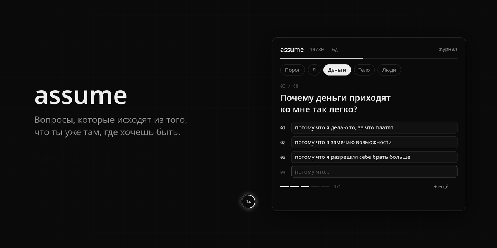

# Assume

Маленький виджет для Windows, который живёт в углу экрана и задаёт тебе один вопрос за раз. Вопросы сформулированы так, будто то, чего ты хочешь, уже произошло:

> Почему деньги приходят ко мне так легко?
> Как я чувствую себя, будучи тем, кем всегда хотел быть?

Под вопросом несколько пустых строк. Следующий вопрос открывается, только когда заполнены все.

## Зачем это

Мозг постоянно фильтрует информацию и пропускает в сознание то, что считает важным. Когда ты задаёшь себе вопрос, он начинает искать ответ. Вопрос «почему у меня ничего не получается» находит сотню причин неудачи. Вопрос «почему у меня всё получается» запускает тот же поиск в другую сторону.

В таком вопросе желаемое уже считается фактом. Спорить с ним не нужно, остаётся только найти объяснение. Пять ответов подряд на один вопрос заставляют копнуть глубже первых очевидных мыслей. Через несколько дней практики ты начинаешь замечать в жизни то, что раньше пролетало мимо: возможности, людей, собственные сильные стороны. Вместе с этим меняются решения и поведение.

Сила здесь в повторении. Поэтому Assume всегда под рукой, напоминает о себе и считает прогресс.

## Как это работает

1. Кружок в углу экрана. Цифра внутри показывает ответы за сегодня, дуга показывает прогресс к дневной цели.
2. Клик или `Ctrl+Alt+Space` открывает окно с вопросом.
3. Пишешь ответы, по одному на строку. Повтор не засчитывается.
4. Когда все строки заполнены, появляется `Далее →`. Ответы уходят в журнал, открывается следующий вопрос. Если вопрос в категории один, он остаётся, строки очищаются.
5. `Esc` прячет окно обратно в кружок. Недописанные ответы сохраняются.

Если ты давно не открывал виджет, кружок начинает мягко пульсировать и звучит тихий сигнал. Звук и интервал настраиваются. Когда дневная цель выполнена, напоминания можно выключить.

## Что внутри

- **Категории.** Порог, Я, Деньги, Тело, Люди, Мастерство. Свои категории и вопросы добавляются в настройках, можно вставить готовый список одним текстом.
- **Число ответов.** Общее в настройках и отдельное для любого вопроса.
- **Генерация вопросов.** Подключи любую OpenAI-совместимую модель (OpenRouter, DeepSeek, OpenAI или локальную Ollama), опиши цель категории, и ИИ допишет новые вопросы. Последнюю генерацию можно отменить.
- **Журнал.** Все ответы по дням, поиск, экспорт в Markdown.
- **Серия дней и дневная цель.** Видны в шапке окна.
- **Размер окна.** Компактный виджет, развёрнутый на весь рабочий стол (`Ctrl+M`) и полный экран (`F11`) для спокойной сессии.
- **Свой угол.** Кружок перетаскивается куда угодно, окно раскрывается в сторону свободного места.

## Клавиши

| | |
|---|---|
| `Ctrl+Alt+Space` | открыть / спрятать из любого окна |
| `Enter` | следующая строка, на заполненной форме: далее |
| `Ctrl+Enter` | далее |
| `Shift+Enter` | ещё одна строка ответа |
| `↑` `↓` | переход между строками |
| `Alt+←` `Alt+→` | предыдущий / следующий вопрос |
| `Ctrl+1…9` | категория |
| `Ctrl+,` | настройки |
| `Ctrl+J` | журнал |
| `Ctrl+M` | развернуть в окне |
| `F11` | полный экран |
| `Esc` | назад, выход из полного экрана, свернуть |

## Данные

Всё хранится локально в `%APPDATA%\Assume\`:

- `config.json`: вопросы, настройки, черновики, ключ API;
- `journal.jsonl`: журнал ответов, одна запись на строку.

В сеть программа обращается только при генерации вопросов и только по адресу, который ты указал сам.

## Стек

Rust и [egui](https://github.com/emilk/egui). Один исполняемый файл, без установщика и рантаймов.
